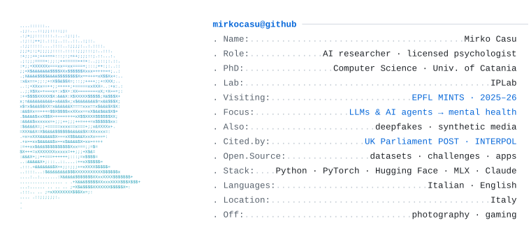
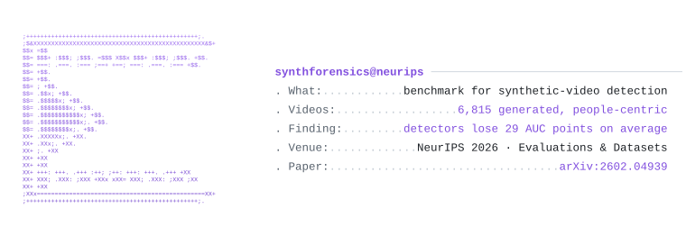
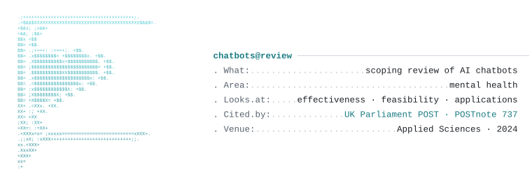
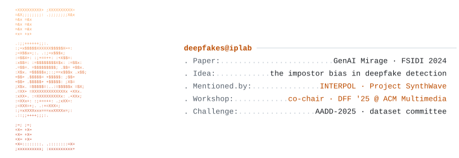

  

# Hi, I'm Mirko 👋🏼

🧠 AI researcher · PhD in Computer Science at the [University of Catania](https://www.unict.it/en) · [Licensed psychologist](https://areariservata.psy.it/albo/iscritto/mirko_casu_218564) · 📍 Italy

I study AI systems that observe, imitate, or judge human behaviour, mainly language models and AI agents, and how they can help or harm mental health and safety. I'm a member of [IPLab](https://iplab.dmi.unict.it/) and was a visiting researcher at [EPFL](https://www.epfl.ch/labs/mints/).

## Research

### SynthForensics

A benchmark that tests deepfake detectors on synthetic videos of people.

 

### AI chatbots for mental health

A scoping review of how well AI chatbots for mental health work, how feasible they are, and where they're used.

 

### Deepfake forensics

Why people and detectors mistake synthetic media for real. I also help run a workshop and a challenge on the topic.

   

I also work on [on-device autism screening from children's gaze](https://doi.org/10.1109/OJCS.2026.3738736) (IEEE OJCS, 2026), with an [Android app](https://github.com/spatam/ASD-Screening-Android-APP), and on [smoking detection with wearable sensors](https://doi.org/10.1109/JBHI.2025.3549255) (IEEE JBHI, 2025). For the full list, see [my publications](https://mirkocasu.github.io/publications/).

## How I work

- As a psychologist, I study how AI systems affect the people who use them, alongside their benchmark scores.
- My evidence comes from benchmarks, scoping reviews, and studies with participants.
- I distil and quantise models so that they run offline on a phone or a laptop.
- I release datasets, challenges, and apps publicly, such as the AADD-2025 challenge and the autism screening app.
- Off work: photography and video games.

## Connect

Email: mirko.casu [AT] live.it 
University email: mirko.casu [AT] phd.unict.it
