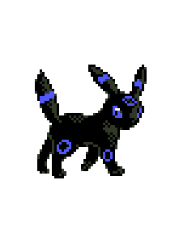
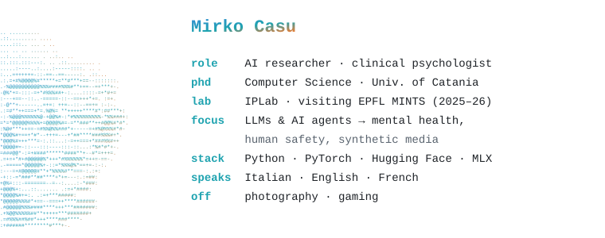

  

# Hi, I'm Mirko 👋🏼

🧠 AI researcher · PhD in Computer Science at the [University of Catania](https://www.unict.it/en) · [Licensed psychologist](https://areariservata.psy.it/albo/iscritto/mirko_casu_218564) · 📍 Catania, Italy 🌋

I study AI systems that observe, imitate or judge human behaviour. I specialise in language models and AI agents, and what they mean for mental health and human safety: how these systems can support people's wellbeing, and how they can put them at risk. I'm a member of [IPLab](https://iplab.dmi.unict.it/) and was recently a visiting researcher at [EPFL](https://www.epfl.ch/labs/mints/).

## What I'm working on

### SynthForensics

How well do deepfake detectors cope with today's people-centric synthetic videos? Not well.

- A benchmark of **6,815** generated videos of people.
- Detectors lose **29 AUC points** on average.
- NeurIPS 2026, Evaluations & Datasets Track.

 

### AI chatbots for mental health

Do AI chatbots actually help people's mental health?

- A scoping review of their effectiveness, feasibility and applications.
- Cited by the UK Parliament POST (POSTnote 737).
- Applied Sciences, 2024.

 

### Deepfake forensics

Why people and detectors fall for synthetic media, and how to build better benchmarks and challenges for it.

- **GenAI Mirage**: the impostor bias in deepfake detection (FSIDI, 2024), mentioned by INTERPOL.
- Co-chair of the DFF '25 workshop at ACM Multimedia 2025.
- Dataset committee of the AADD-2025 challenge.

   

Also: [on-device autism screening](https://doi.org/10.1109/OJCS.2026.3738736) from children's gaze (IEEE OJCS '26, [app](https://github.com/spatam/ASD-Screening-Android-APP)) and [smoking detection and cessation](https://doi.org/10.1109/JBHI.2025.3549255) with wearables (IEEE JBHI '25). The full list is on [my website](https://mirkocasu.github.io/publications/).

<!-- DRAFT: written from what is already public on the website. Edit freely. -->

## How I work

- Psychologist first, computer scientist second: I look at what AI systems do to people, not only at what they score.
- Evidence over hype: benchmarks, scoping reviews and controlled studies with real participants.
- Models that run where people are: distilled and quantised to work offline, on a phone or a laptop.
- Open by default: datasets, challenges and apps go public when they can.
- Catania, Sicily. Photography and gaming when I'm off.

## Connect

Reach me at mirko.casu [AT] live.it

---

### Philosophy

<!-- PLACEHOLDER: replace with your own motto and one or two lines about it. -->

> _Your motto here._
